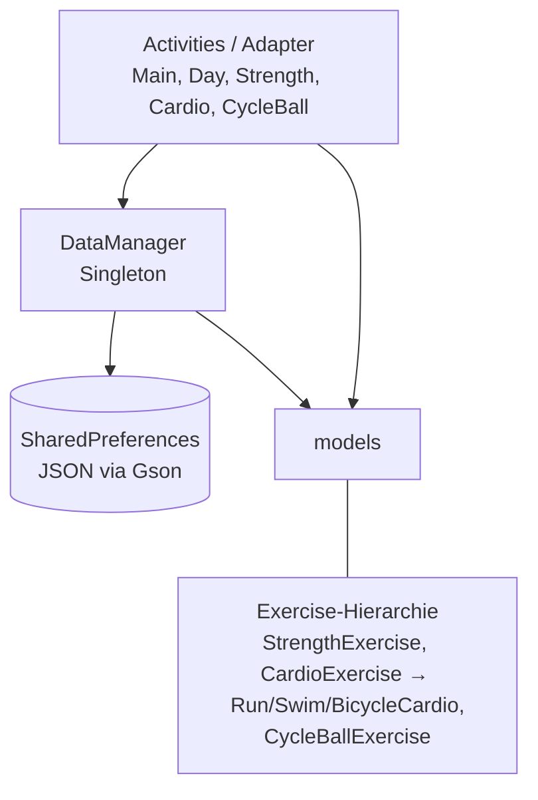

# TrainingsApp – hybride Trainingsplanung (Android)

Android-App zum Planen und Protokollieren von Trainingswochen für **Kraft, Ausdauer (Laufen,
Schwimmen, Radfahren) und Radball**. Pläne aus Vorwochen lassen sich mit einem Tap übernehmen,
die tatsächlich erbrachten Werte werden pro Einheit nachgetragen.

## Funktionen

- **Wochenübersicht** mit Navigation durch die Kalenderwochen
- **Hybrides Training:** eigene Eingabemasken für Kraft (Sätze mit Gewicht, Wiederholungen, RIR),
  Ausdauer (Pace, Puls, RPE) und Radball
- **Wochen kopieren:** Eine Woche wird als „geplant“ in die nächste übernommen, die Ist-Werte
  werden dabei zurückgesetzt (tiefe Kopie, kein geteilter Zustand)
- **Drag & Drop** zum Umsortieren von Übungen und Einheiten
- **Lokale Speicherung** als JSON in `SharedPreferences` (Gson), ohne Konto und ohne Server

## Architektur



- Ein **Singleton `DataManager`** hält die Daten und speichert sie zentral; so sehen alle
  Activities denselben Stand.
- Die Übungsarten sind eine **Klassenhierarchie** (Vererbung und Polymorphie). Damit beim
  Laden wieder die richtige Unterklasse entsteht, nutzt der `DataManager` eigene Gson-Serializer
  und -Deserializer.
- UI mit Material Design 3 und View Binding, Java 11, minSdk 34.

## Tests

| Art | Klassen | Prüft u. a. |
|---|---|---|
| Unit-Tests (JVM) | `ExerciseDetailTest`, `NumberUtilsTest` | Sätze hinzufügen/entfernen, Zahlen-Parsing mit Fallback |
| Instrumentiert (Gerät/Emulator) | `DataManagerTest`, `NavigationAndUiTest` | Wochenkopie ohne Ist-Werte, Polymorphes Speichern/Laden, defektes JSON, Singleton, Navigation |

```bash
./gradlew testDebugUnitTest          # Unit-Tests
./gradlew connectedDebugAndroidTest  # braucht Emulator oder Gerät
```

Bei jedem Push baut GitHub Actions die App und führt die Unit-Tests aus
(`.github/workflows/ci.yml`).

## Bauen und starten

1. Android Studio (aktuelle Version) öffnen und das Projekt importieren
2. Emulator oder Gerät mit Android 14 (API 34) oder neuer wählen
3. `app` starten – oder per Kommandozeile `./gradlew installDebug`

## JavaDoc

Die API-Dokumentation ist nicht eingecheckt, sondern wird bei Bedarf in Android Studio
(*Tools → Generate JavaDoc*) erzeugt.
