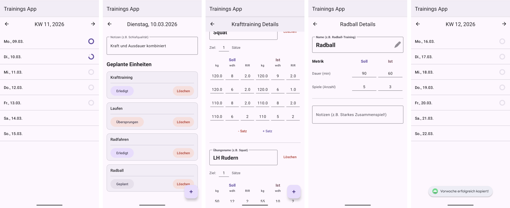
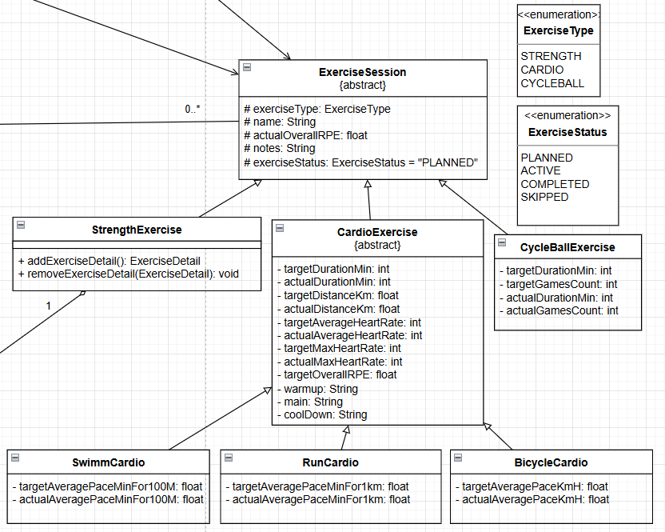
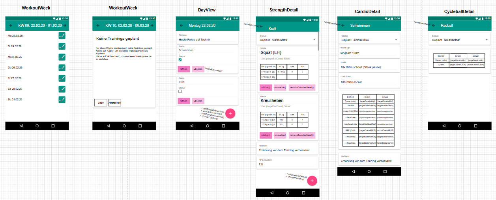

# Training Planner – Android-App für hybride Trainingsplanung

Native Android-App (Java) zum Planen und Protokollieren von Trainingswochen für **Kraft, Ausdauer
(Laufen, Schwimmen, Radfahren) und Radball**. Bestehende Apps decken meist nur eine Sportart ab,
diese App führt Kraft- und Ausdauerkennzahlen in einer gemeinsamen Wochenübersicht zusammen.
Geplante Werte (Soll) und tatsächlich erbrachte Werte (Ist) stehen nebeneinander.

Entstanden im Studium (Softwareentwicklung, Projekt Software Development) als Einzelprojekt vom
Konzept über Entwurf und Umsetzung bis zu Tests und Dokumentation.



## Funktionen

- **Wochenübersicht** mit Navigation durch die Kalenderwochen und Status pro Tag
- **Eigene Eingabemasken je Sportart:** Kraft mit Sätzen (Gewicht, Wiederholungen, RIR), Ausdauer
  mit Dauer, Distanz, Pace, Puls und RPE, Radball mit Dauer und Spielen
- **Soll und Ist:** Pro Einheit werden Zielwerte geplant und die tatsächlichen Werte nachgetragen
- **Woche kopieren:** Eine Woche wird als „geplant“ in die nächste übernommen, die Ist-Werte
  werden dabei zurückgesetzt (tiefe Kopie ohne geteilten Zustand)
- **Drag & Drop** zum Umsortieren von Übungen und Einheiten
- **Lokale Speicherung** als JSON, ohne Konto und ohne Server

## Technik

| Bereich | Umsetzung |
|---|---|
| Sprache, Plattform | Java 11, Android (minSdk 34, targetSdk 36) |
| Oberfläche | Material Design 3, View Binding, Texte in `strings.xml`, Screenreader-Unterstützung |
| Daten | Gson, JSON in `SharedPreferences` |
| Tests | JUnit, Espresso |
| Build und CI | Gradle, GitHub Actions |
| Dokumentation | JavaDoc, Skizzen und UML mit draw.io |

## Architektur und Klassenmodell

Die App folgt einem MVC-orientierten Aufbau:

- **Models:** Fachklassen für die Trainingslogik
- **DataManager (Singleton):** zentraler Zugriff auf Daten und Speicherung, alle Activities sehen
  denselben Stand
- **Activities und Adapter:** Trennung von Oberfläche und Datenaufbereitung, zum Beispiel
  `ExerciseAdapter` für die Liste in der Tagesansicht

Die Übungsarten sind eine **Klassenhierarchie** mit der abstrakten Basisklasse
`ExerciseSession`. Kraft, Ausdauer und Radball erben davon und ergänzen ihre eigenen Kennzahlen.
Dadurch lassen sich alle Sportarten in einer gemeinsamen Tagesansicht verwalten (Polymorphie). Damit
beim Laden aus JSON wieder die richtige Unterklasse entsteht, nutzt der `DataManager` eigene
Gson-Serializer und -Deserializer.



## Entwurf

Vor der Umsetzung entstanden User Stories, Wireframes und ein UML-Klassendiagramm. Die Wireframes
zeigen Wochenübersicht, Tagesansicht und die Detailmasken je Sportart.



Organisiert wurde das Projekt mit Scrum und einem Kanban-Board, mit flexibler Sprint-Planung.

## Qualitätssicherung

| Art | Klassen | Prüft unter anderem |
|---|---|---|
| Unit-Tests (JVM) | `ExerciseDetailTest`, `NumberUtilsTest` | Sätze hinzufügen und entfernen, Zahlen-Parsing mit Fallback |
| Instrumentiert (Gerät oder Emulator) | `DataManagerTest`, `NavigationAndUiTest` | Wochenkopie ohne Ist-Werte, Speichern und Laden der Unterklassen, defektes JSON, Navigation |

```bash
./gradlew testDebugUnitTest          # Unit-Tests
./gradlew connectedDebugAndroidTest  # braucht Emulator oder Gerät
```

Bei jedem Push baut GitHub Actions die App und führt die Unit-Tests aus
(`.github/workflows/ci.yml`).

## Bauen und starten

1. Android Studio öffnen und das Projekt importieren
2. Emulator oder Gerät mit Android 14 (API 34) oder neuer wählen
3. Die Konfiguration `app` starten oder per Kommandozeile `./gradlew installDebug`

## Ausblick

- Cloud-Synchronisation (zum Beispiel Firebase) mit Benutzerkonten
- Auswertungen des Trainingsfortschritts als Diagramme
- Frei benennbare Parameter für weitere Sportarten
